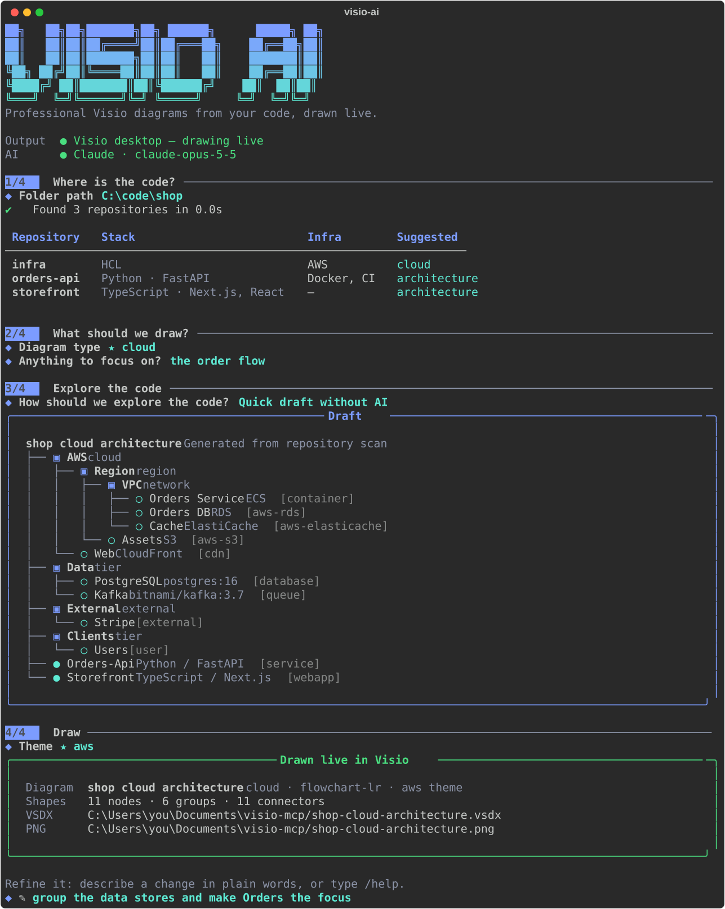
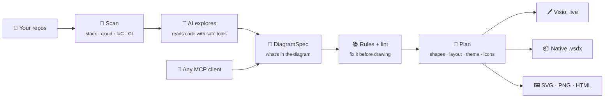
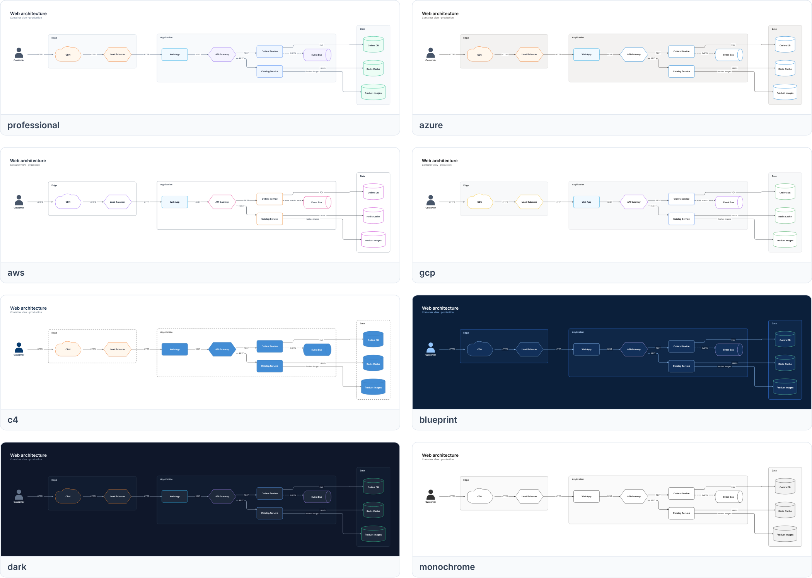
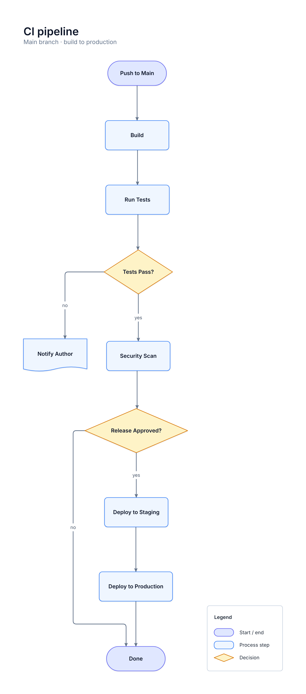
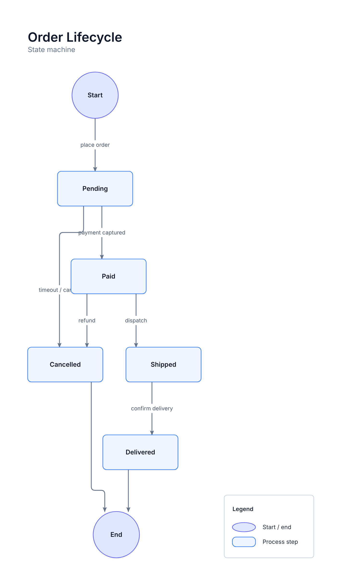
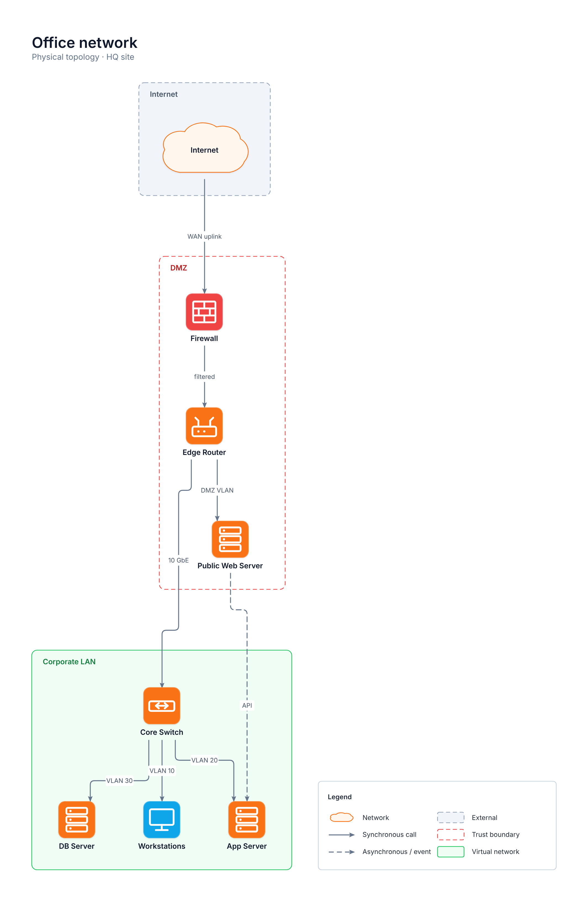
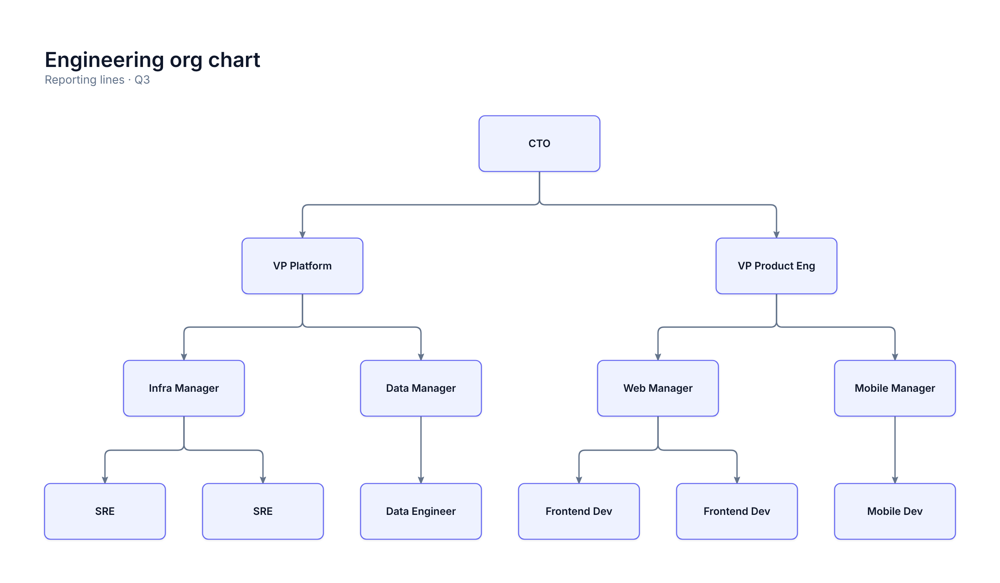

<div align="center">

# ✦ visio-mcp

### Point it at your code. Watch a professional Visio diagram draw itself.

[](https://www.python.org/)
[](https://modelcontextprotocol.io/)
[](docs/live-visio.md)
[](docs/cli.md#ai-providers)
[](#%EF%B8%8F-development)

[Quick start](#-quick-start) · [See it](#-see-it-in-action) · [Features](#-what-makes-it-different) · [Diagram types](#%EF%B8%8F-14-diagram-types) · [Themes](#-8-themes) · [AI apps](#-use-it-from-your-ai-coding-app) · [Docs](#-documentation)

<br>


<sub>Drawn by visio-mcp from a 38-line spec: official Azure icons, nested subscription › region › VNet › subnets, themed, labeled, with a legend.</sub>

</div>

<br>

**visio-mcp** turns a folder of code into the kind of architecture diagram a senior architect
would draw. An AI of your choice reads the repo. It drafts the diagram following real
diagramming rules (C4, cloud provider conventions, flowchart standards). Then visio-mcp
**opens your Visio app and draws it shape by shape**, right in front of you. Then you just talk
to it: *"group the databases"*, *"make it left to right"*, *"switch to the AWS theme"*.

No Visio? You still get a native `.vsdx` (opens in Visio desktop or Visio for the web) plus
SVG, PNG and an interactive HTML preview. And because it's an **MCP server** too, Claude Code,
GitHub Copilot, Codex, Gemini CLI and any other MCP client can use it as a drawing tool.

<br>

## ⚡ Quick start

You need **Python 3.12+** and **[uv](https://docs.astral.sh/uv/)**. Live drawing needs
**Windows + Visio desktop** (Professional or Plan 2); everything else works anywhere.

```powershell
uv tool install git+https://github.com/sumsam-ali-sac/visio-mcp   # 1. install
visio-ai setup                                                     # 2. pick your AI (optional)
visio-ai                                                           # 3. go
```

That's it. Paste a folder path when it asks, and watch.

> [!TIP]
> Run `visio-ai doctor` any time. It checks Visio, your AI provider, the cloud icons and the
> preview renderers, and tells you exactly how to fix anything missing.

<br>

## 🎬 See it in action

<div align="center">

</div>

1. **Where is the code?** Paste a repo, or a folder full of repos. It finds them all and shows
   each one's stack, cloud, Docker/CI setup and the diagram it suggests.
2. **What should we draw?** The best-fitting diagram type is starred ★. Add a focus in plain
   words if you like: *"only the ingestion path"*.
3. **Explore the code.** Your AI reads entrypoints, configs, IaC, compose files and CI with a
   live activity feed (📂 📄 🔎). Or hand the job to your AI coding app, or take a quick draft
   with no AI at all.
4. **Draw.** Pick a theme and Visio comes to the front and builds the diagram. Then keep
   chatting at the `✎` prompt until it's exactly right.

<br>

## ✨ What makes it different

<table>
<tr>
<td width="50%" valign="top">

### 🖊️ Drawn live, fully editable
Opens Visio, or `--attach` to the window you already have open, and builds the diagram
shape by shape. You get real Visio shapes, containers and glued connectors that you can keep
editing, not a pasted picture.

</td>
<td width="50%" valign="top">

### 🎨 Looks professionally designed
Eight themes control fonts, palettes, line weights, corners, group frames and backgrounds.
Every diagram gets a title block and a legend. Labels are cased properly (*API Gateway*,
*PostgreSQL DB*). Nodes can show a technology line, C4-style.

</td>
</tr>
<tr>
<td valign="top">

### 📐 A layout engine that respects groups
Tiers, trust boundaries and nested cloud hierarchies (cloud › region › network › subnet)
stay tidy. Shapes and groups never overlap, and edges get their own channels. Every example
is audited under every layout.

</td>
<td valign="top">

### 📚 Knows the rules of every diagram
It ships ground rules for 14 diagram types and for Azure, AWS and Google Cloud conventions.
The AI follows them, and a linter checks every draft against them before anything is drawn.

</td>
</tr>
<tr>
<td valign="top">

### ☁️ Official cloud icons
179 shape kinds, including 102 Azure, AWS and Google Cloud services, all drawn with the
vendors' official architecture icons after one `visio-ai icons install`.

</td>
<td valign="top">

### 🤖 Bring your own AI, or none
Use Claude, Gemini, Azure OpenAI, OpenAI or a local Ollama model, or hand off to Claude Code,
Gemini CLI, Codex or Copilot CLI. `--offline` drafts from a static scan with no AI at all.

</td>
</tr>
</table>

<br>

## 🧭 How it works



The AI (or you, or your MCP client) only decides **what** is in the diagram: nodes, edges,
groups and the diagram type. visio-mcp decides **how it looks**: shapes, sizes, positions,
routes, fonts, colors, title and legend. That split is why the output looks consistent and
professional every time.

<br>

## 🗺️ 14 diagram types

Each type has its own conventions, layout, checklist and example. Run `visio-ai rules <type>`
to read them.

| Type | Use it when you need… | Example |
|---|---|---|
| `architecture` | the components of a system and how they call each other | [web-architecture](examples/web-architecture.json) |
| `cloud` | which Azure, AWS or Google Cloud services implement a system | [azure-rag-app](examples/azure-rag-app.json) · [aws-serverless](examples/aws-serverless.json) |
| `c4-context` | the big picture: your system, its users and the systems around it | [c4-context](examples/c4-context.json) |
| `c4-container` | the apps, services and stores inside one system | [rules](docs/reference/rules/c4-container.md) |
| `deployment` | what runs where: environments, hosts, clusters and networks | [rules](docs/reference/rules/deployment.md) |
| `network` | sites, subnets, routing, firewalls and devices | [network](examples/network.json) |
| `dataflow` | where data comes from, how it's transformed and where it ends up | [rules](docs/reference/rules/dataflow.md) |
| `pipeline` | the stages of a build, release or data pipeline | [rules](docs/reference/rules/pipeline.md) |
| `flowchart` | the steps and decisions of one process | [ci-pipeline](examples/ci-pipeline.json) |
| `swimlane` | a process that crosses people, teams or systems | [refund-swimlane](examples/refund-swimlane.json) |
| `state` | one thing moving through states driven by events | [order-states](examples/order-states.json) |
| `erd` | tables, relationships and cardinalities | [order-erd](examples/order-erd.json) |
| `org` | reporting lines | [org-chart](examples/org-chart.json) |
| `mindmap` | one topic broken into themes and ideas | [rules](docs/reference/rules/mindmap.md) |

<br>

## 🎨 8 themes

<div align="center">

</div>

<br>

| Theme | Best for |
|---|---|
| `professional` | Clean light theme with soft category tints. The default; good for any audience. |
| `azure` | Microsoft Fluent palette, in the style of Azure Architecture Center diagrams. |
| `aws` | AWS conventions: AWS Cloud, Region, VPC and subnet groups. |
| `gcp` | Google Cloud palette with project, region and VPC groups. |
| `c4` | C4 model colors: people dark blue, systems blue, external grey. |
| `blueprint` | Dark navy with crisp light lines. Great on screens and slides. |
| `dark` | Slate dark mode with vivid category accents. |
| `monochrome` | Greyscale, print and photocopy friendly. |

Leave the theme on `auto` and it picks for you: `azure`/`aws`/`gcp` for cloud diagrams,
`c4` for C4, `professional` otherwise. Switch any time with `/theme` in the studio.

<br>

## ☁️ Official cloud icons

```powershell
visio-ai icons install        # Azure + AWS + Google Cloud, once
```

Every `azure-*`, `aws-*` and `gcp-*` kind is drawn with its official architecture icon:
imported into Visio, embedded in the `.vsdx`, and inlined in the previews. The packs come
from Microsoft, AWS and Google directly, with an automatic fallback for locked-down
networks. Behind a strict proxy, download the zip yourself and run
`visio-ai icons install azure --from C:\Downloads\Azure_Icons.zip`. Any node can also use
your own `.svg`/`.png` with `"icon": "path/to/logo.svg"`. [More →](docs/cloud-icons.md)

<br>

## 🤖 Bring your own AI

`visio-ai setup` walks you through it, tests the connection, and stores the choice in your user
config folder. Keys found in your environment are picked up automatically.

| Provider | Environment variables | Default model |
|---|---|---|
| **Claude** (Anthropic) | `ANTHROPIC_API_KEY` | `claude-opus-5-5` |
| **Gemini** (Google) | `GEMINI_API_KEY` or `GOOGLE_API_KEY` | `gemini-2.5-pro` |
| **Azure OpenAI** | `AZURE_OPENAI_ENDPOINT`, `AZURE_OPENAI_DEPLOYMENT`, and `AZURE_OPENAI_API_KEY` *or* your Azure sign-in (`az login`) | your deployment |
| **OpenAI** | `OPENAI_API_KEY` | `gpt-5` |
| **Ollama** (local) | running on `localhost:11434` | `qwen3:latest` |

> [!NOTE]
> **What the AI sees.** The agent can only list, read and search files inside the folders you
> picked: it can't write anything or run code. Private keys and binaries are never read, and
> secrets in configs (keys, tokens, passwords, connection strings, `.env` values) are masked
> before they're sent. With Ollama nothing leaves your machine, and with `--offline` no AI is
> involved at all.

<br>

## 🔌 Use it from your AI coding app

Already living in Claude Code, Gemini CLI, Codex or Copilot CLI? One command registers the
visio MCP server with that app and launches it on your repo, with a ready-made prompt:

```powershell
visio-ai handoff C:\code\shop --tool claude     # or: gemini · codex · copilot
```

Or connect it yourself:

```powershell
claude mcp add visio -- uvx --from git+https://github.com/sumsam-ali-sac/visio-mcp visio-mcp
```

<details>
<summary><b>VS Code · Copilot CLI · Codex · Gemini CLI · Claude Desktop configs</b></summary>

<br>

**VS Code** — `.vscode/mcp.json`

```json
{"servers": {"visio": {"type": "stdio", "command": "uvx",
  "args": ["--from", "git+https://github.com/sumsam-ali-sac/visio-mcp", "visio-mcp"]}}}
```

**GitHub Copilot CLI** — `~/.copilot/mcp-config.json`

```json
{"mcpServers": {"visio": {"type": "local", "command": "uvx",
  "args": ["--from", "git+https://github.com/sumsam-ali-sac/visio-mcp", "visio-mcp"], "tools": ["*"]}}}
```

**Codex CLI** — `~/.codex/config.toml`

```toml
[mcp_servers.visio]
command = "uvx"
args = ["--from", "git+https://github.com/sumsam-ali-sac/visio-mcp", "visio-mcp"]
```

**Gemini CLI** — `~/.gemini/settings.json`

```json
{"mcpServers": {"visio": {"command": "uvx",
  "args": ["--from", "git+https://github.com/sumsam-ali-sac/visio-mcp", "visio-mcp"]}}}
```

**Claude Desktop** — `claude_desktop_config.json`

```json
{"mcpServers": {"visio": {"command": "uvx",
  "args": ["--from", "git+https://github.com/sumsam-ali-sac/visio-mcp", "visio-mcp"]}}}
```

</details>

Then just ask: *"Draw a cloud architecture diagram of this repo in Visio."*

<details>
<summary><b>MCP tools, resources and settings</b></summary>

<br>

| Tool | What it does |
|---|---|
| `get_authoring_guide` | How to write a great spec and run the review loop |
| `get_diagram_rules(type, provider?)` | Ground rules, checklist and example for a diagram type |
| `list_kinds(provider?)` · `list_themes` | Shape kinds and themes |
| `lint_diagram(spec)` | Rule findings, without drawing |
| `render_diagram(spec)` | Draw it (live in Visio), save `.vsdx` + exports, return a preview image |
| `patch_diagram(ops)` | Edit nodes, edges, groups, title, theme or layout; it redraws |
| `inspect_diagram` · `open_diagram(path)` · `export_diagram(format)` | Work with the open diagram |
| `install_icons(provider)` | Install the official cloud icons |
| `list_stencils` · `list_masters` | Diagnose which Visio stencils exist |

Resource `visio://rules/{type}` · prompt `diagram(subject, source, diagram_type)`.

| Environment variable | Default | |
|---|---|---|
| `VISIO_MCP_OUT` | `Documents/visio-mcp` | Output folder |
| `VISIO_MCP_TARGET` | `auto` | `visio` (require Visio), `native` (never use Visio) |
| `VISIO_MCP_LIVE` | `1` | Draw in the visible Visio window, shape by shape |
| `VISIO_MCP_ATTACH` | `0` | `1` = draw into the Visio you already have open |
| `VISIO_MCP_HEADLESS` | `0` | `1` = hidden Visio, for servers and CI |
| `VISIO_MCP_LIVE_DELAY` | `0.05` | Seconds between shapes while drawing live |
| `VISIO_MCP_ICONS` | user cache | Where the cloud icon packs live |

</details>

<br>

## ⌨️ Cheat sheet

**In the studio**, type a change in plain words, or a command:

| | |
|---|---|
| *"add the Stripe webhook"* · *"group the queues"* · *"make Orders the focus"* | describe any change |
| `/theme [name]` · `/layout [name]` | restyle or re-lay-out |
| `/export png\|svg\|pdf\|html` | export |
| `/spec` · `/save [file]` | see or save the spec (redraw later with `visio-ai render`) |
| `/lint` | rule findings |
| `/undo` · `/new` · `/open` · `/help` · `/quit` | |

**From the command line:**

| Command | What it does |
|---|---|
| `visio-ai` | the interactive studio |
| `visio-ai draw PATH --type cloud --focus "…"` | explore and draw with no questions (scripts, CI) |
| `visio-ai render spec.json` | draw a saved spec |
| `visio-ai scan PATH [--digest]` | profile repos; `--digest` shows exactly what the AI sees |
| `visio-ai setup` · `visio-ai doctor` | pick your AI · check your machine |
| `visio-ai icons [install\|remove]` | official cloud icon packs |
| `visio-ai handoff PATH --tool claude` | let your AI coding app draw it |
| `visio-ai themes` · `kinds` · `rules TYPE` | browse themes, shapes and rules |
| `visio-ai examples` | draw every example |

Handy flags: `--attach` · `--native` · `--no-live` · `--offline` · `--theme T` · `--out DIR` · `--format pdf`

<br>

## 🧩 The diagram spec

Under the hood every diagram is a small JSON document that describes **meaning, not
geometry**. Everything visual is derived from it. Write one by hand, save one from the studio
(`/save`), or let an agent write it.

```json
{
  "title": "Orders Platform",
  "subtitle": "Container view · v2",
  "type": "architecture",
  "groups": [
    {"id": "core", "label": "Order Services", "kind": "system"},
    {"id": "data", "label": "Data", "kind": "tier"}
  ],
  "nodes": [
    {"id": "customer", "label": "Customer", "kind": "user"},
    {"id": "api", "label": "Orders API", "kind": "api", "technology": "Python / FastAPI",
     "group": "core", "emphasis": true},
    {"id": "bus", "label": "Order Events", "kind": "queue", "technology": "Kafka", "group": "core"},
    {"id": "db", "label": "Orders DB", "kind": "database", "technology": "PostgreSQL", "group": "data"}
  ],
  "edges": [
    {"source": "customer", "target": "api", "label": "HTTPS"},
    {"source": "api", "target": "db", "label": "reads/writes"},
    {"source": "api", "target": "bus", "label": "publishes", "style": "dashed"}
  ]
}
```

```powershell
visio-ai render orders.json
```

<details>
<summary><b>Field reference</b></summary>

<br>

| Field | Notes |
|---|---|
| `title`, `subtitle` | the title block; use the subtitle for scope, version or date |
| `type` | `auto` or one of the 14 types; drives layout, theme and rules |
| `layout` | `auto`, `flowchart-tb` / `-lr`, `tree-tb` / `-lr`, `swimlane-lr` / `-tb`, `radial`, `circular`, `grid`, `none` |
| `theme` | `auto` or one of the 8 themes |
| `legend` | legend of the shapes and line styles used (default `true`) |
| `nodes[]` | `id`, `label`, `kind` (179 kinds: `visio-ai kinds`), `group`, `technology`, `description`, `emphasis`, `icon`, `fill`, `x`/`y` |
| `edges[]` | `source`, `target`, `label`, `style` (`solid` sync · `dashed` async · `dotted` optional), `arrow`, `color` |
| `groups[]` | `id`, `label`, `kind` (tier, system, boundary, cloud, region, zone, network, subnet, cluster, environment, lane, external), `parent` for nesting, `fill` |

Full guide: [docs/spec.md](docs/spec.md) · JSON schema: [diagram-spec.schema.json](docs/reference/diagram-spec.schema.json)

</details>

<br>

## 🖼️ Gallery

Every image below was drawn by visio-mcp from the specs in [`examples/`](examples).

<table>
<tr>
<td width="50%"><br><sub><b>Cloud</b> · AWS serverless, event-driven</sub></td>
<td width="50%"><br><sub><b>Architecture</b> · tiers, sync and async flows</sub></td>
</tr>
<tr>
<td><br><sub><b>Swimlane</b> · a process across three teams</sub></td>
<td><br><sub><b>Flowchart</b> · CI pipeline with decisions</sub></td>
</tr>
<tr>
<td><br><sub><b>C4 context</b> · the system and its neighbours</sub></td>
<td><br><sub><b>State machine</b> · an order's lifecycle</sub></td>
</tr>
<tr>
<td><br><sub><b>Network</b> · DMZ, LAN and VLANs</sub></td>
<td><br><sub><b>Org chart</b> · a tidy tree</sub></td>
</tr>
</table>

<br>

## ❓ FAQ

<details>
<summary><b>Do I need Microsoft Visio?</b></summary>

Only for drawing **live**. Without Visio (macOS, Linux, or no license) you get a native `.vsdx`
that opens in Visio desktop or Visio for the web, plus SVG, PNG and an HTML viewer. Live drawing
needs Windows with Visio desktop (Professional or Plan 2); Visio for the web can't be automated.
</details>

<details>
<summary><b>Is my code sent anywhere?</b></summary>

Only to the AI provider you choose, and only the files the agent decides to read. Secrets are
masked first. Use Ollama to keep everything on your machine, or `--offline` to skip AI entirely.
</details>

<details>
<summary><b>Can I edit the diagram afterwards?</b></summary>

Yes. It's made of native Visio shapes, containers and glued connectors, so you can move, restyle
and extend it by hand. Or keep refining it by chatting in the studio, or with `patch_diagram`
from an MCP client.
</details>

<details>
<summary><b>What does it cost?</b></summary>

visio-mcp itself costs nothing; you pay your AI provider for the tokens the agent uses. A typical
exploration is a few dozen tool calls. Ollama and `--offline` are free.
</details>

<details>
<summary><b>It drew a plain rectangle instead of an icon.</b></summary>

For cloud services, run `visio-ai icons install`. For other kinds, your Visio edition may not
include that stencil; the warning suggests an alternative kind, and `visio-ai doctor` shows what's
available. More fixes: [troubleshooting](docs/troubleshooting.md).
</details>

<br>

## 🏗️ Project structure

Each package owns one concern and each file does one job. Packages only import packages above
them in this list.

```
src/visio_mcp/
├── spec/      the DiagramSpec contract and patch ops
├── catalog/   179 shape kinds → Visio masters
├── rules/     ground rules per diagram type and cloud provider
├── style/     themes, casing, text metrics, shape sizes
├── lint/      resolve 'auto', fix casing, check the rules
├── icons/     official Azure / AWS / Google Cloud icons
├── layout/    group-aware layout engines and edge routing
├── plan/      spec → DiagramPlan: every visual decision, made once
├── output/    visio/ (live, over COM) · vsdx/ (native file) · svg/ (previews) · drawer.py
├── repo/      discover and profile repos, sandboxed file access, no-AI drafts
├── ai/        Claude / Gemini / Azure OpenAI / OpenAI / Ollama and the exploring agent
├── cli/       the visio-ai terminal app
└── mcp/       the MCP server
```

How each piece fits together, and where to make each kind of change (a theme, a shape kind, a
rule, a layout, an AI provider, a command): [docs/architecture.md](docs/architecture.md).

<br>

## 🛠️ Development

```powershell
git clone https://github.com/sumsam-ali-sac/visio-mcp
cd visio-mcp
uv sync

uv run visio-ai                     # run the app from your checkout
uv run pytest                       # 1,261 tests, no Visio needed
uv run pytest -m visio              # the Visio COM layer, on Windows with Visio
uv run python scripts/smoke.py      # draw every example live, patch, inspect, export
uv run python scripts/gen_docs.py   # regenerate reference docs (--gallery for images)
uv run --with playwright python scripts/gen_readme_assets.py   # regenerate the README images
```

<br>

## 📚 Documentation

| | |
|---|---|
| 🚀 [Getting started](docs/getting-started.md) | Install and draw your first diagram in two minutes |
| ⌨️ [The terminal app](docs/cli.md) | The studio, every command and flag, AI providers, handoff |
| 🔌 [The MCP server](docs/mcp-server.md) | Connect any MCP client; tools, patch ops, settings |
| 🧩 [Writing specs](docs/spec.md) | Nodes, edges, groups and nesting, layouts, the review loop |
| 🗺️ [Diagram types & rules](docs/reference/diagram-types.md) | The conventions for all 14 diagram types |
| ☁️ [Cloud icons](docs/cloud-icons.md) | Official Azure, AWS and Google Cloud icons |
| 🖊️ [Live Visio](docs/live-visio.md) | How live drawing and attaching to your Visio work |
| 🎨 [Themes](docs/reference/themes.md) · 🧱 [Shape kinds](docs/reference/kinds.md) | Every theme and all 179 shape kinds |
| 🏗️ [How it works](docs/architecture.md) | Packages, layering and how to extend each one |
| 🩺 [Troubleshooting](docs/troubleshooting.md) | Visio, previews, AI providers, icons |

<br>

<div align="center">
<sub>Built for people who'd rather ship than nudge boxes around in Visio.</sub>
</div>
