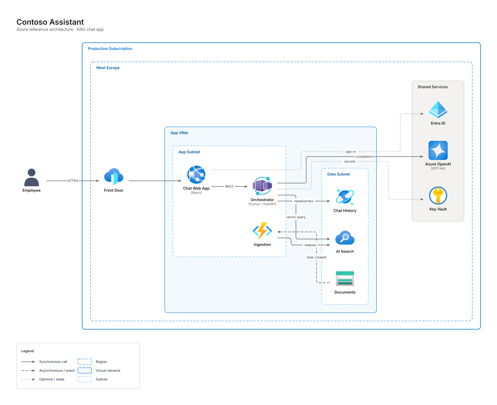
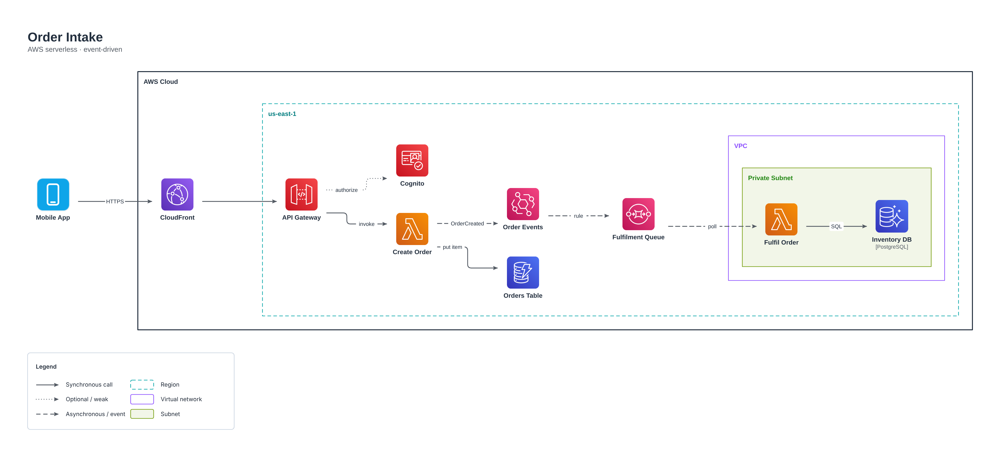
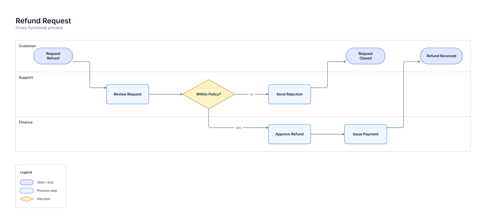
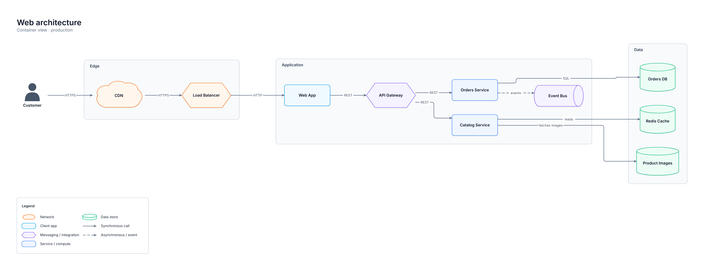
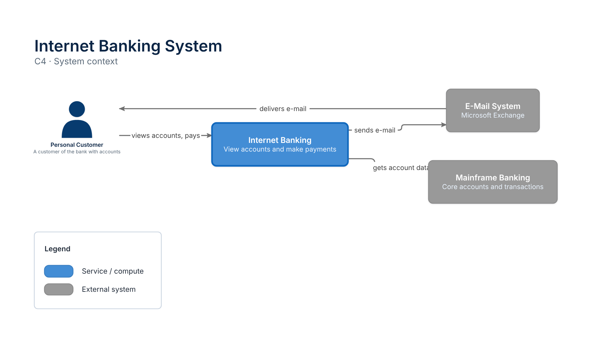

# visio-mcp

**Professional Microsoft Visio diagrams from your code, drawn live in front of you.**

Point it at a cloned repo (or a folder of repos). An AI of your choice (Claude, Gemini, Azure
OpenAI, OpenAI or a local Ollama model) explores the code, drafts the diagram by the rules a
senior architect would follow, and visio-mcp opens **your Visio desktop app and draws it shape
by shape**: themed, grouped, labeled, with a title block and a legend. Then you refine it by
chatting: *"group the databases"*, *"make it left to right"*, *"use the AWS theme"*.

It is also an MCP server, so Claude Code, GitHub Copilot, VS Code, Codex, Gemini CLI or any
MCP client can draw diagrams the same way.

<p align="center"></p>

```
            ┌────────────────────────── visio-ai (terminal) ──────────────────────────┐
your repo ─►│ scan ─► AI agent explores code ─► DiagramSpec ─► rules + lint ─► plan   │─► Visio desktop, live
            └─────────────────────────────────────────────────────────────────────────┘   (or native .vsdx + SVG/PNG/HTML)
MCP client ──► visio-mcp server ───────────────────► DiagramSpec ─► … same pipeline …
```

## Highlights

- **Live in Visio.** Opens Visio (or attaches to the window you already have open with
  `--attach`) and builds the diagram in front of you. Native, editable shapes, containers
  and glued connectors — not a picture.
- **Looks professionally made.** Eight themes (professional, azure, aws, gcp, c4, blueprint,
  dark, monochrome) control fonts, colors, line weights, corner rounding, group frames and
  page background. Labels are Title Cased with acronyms kept (*API Gateway*, *PostgreSQL DB*);
  edge labels read as lowercase phrases (*publishes events*, *HTTPS*). Nodes can carry a
  technology line and a description, C4-style.
- **Layout that respects groups.** A layered layout engine keeps tiers, trust boundaries and
  nested cloud hierarchies (cloud › region › network › subnet) tidy and non-overlapping, with
  orthogonal routes. Swimlanes, trees, radial and grid layouts too.
- **Ground rules for every diagram type.** Flowchart, architecture, cloud (Azure / AWS / GCP),
  C4 context and container, deployment, network, data flow, pipeline, ERD, org chart,
  swimlane, state machine and mind map — each with conventions, a checklist and an example
  the AI follows. A linter checks specs against them.
- **Official cloud icons.** 179 shape kinds, including ~100 Azure, AWS and Google Cloud
  services drawn with the vendors' official architecture icons (`visio-ai icons install`), in
  Visio, in the `.vsdx` and in previews.
- **Works without Visio.** On macOS/Linux (or without a Visio license) it writes a native
  `.vsdx` that opens in Visio desktop or Visio for the web, plus SVG, PNG and an interactive
  HTML preview.
- **Bring your own AI**, or none: a quick draft from a static scan (manifests, docker-compose,
  Terraform/Bicep, Kubernetes, CI workflows) works offline.

## Documentation

[Getting started](docs/getting-started.md) · [The terminal app](docs/cli.md) ·
[The MCP server](docs/mcp-server.md) · [Writing specs](docs/spec.md) ·
[Diagram types & rules](docs/reference/diagram-types.md) · [Cloud icons](docs/cloud-icons.md) ·
[Live Visio](docs/live-visio.md) · [Themes](docs/reference/themes.md) ·
[Shape kinds](docs/reference/kinds.md) · [How it works](docs/architecture.md) ·
[Troubleshooting](docs/troubleshooting.md)

## Install

Requirements: Python 3.12+ and [uv](https://docs.astral.sh/uv/). For live drawing: Windows with
Microsoft Visio desktop (Professional or Plan 2).

```powershell
uv tool install git+https://github.com/sumsam-ali-sac/visio-mcp
visio-ai doctor
```

Or from a clone: `git clone https://github.com/sumsam-ali-sac/visio-mcp && cd visio-mcp && uv sync`,
then prefix commands with `uv run`.

## The terminal app: `visio-ai`

```powershell
visio-ai
```

The studio walks you through four steps:

1. **Where is the code?** Paste a path (`C:\code\shop` or a folder holding many repos). It finds
   the repos and shows each one's stack, cloud, Docker/CI and the diagram it suggests.
2. **What should we draw?** Pick a diagram type (the best fit is starred) and, optionally, a
   focus in plain words: *"the payment flow"*, *"only the data platform"*.
3. **Explore the code.** Your AI agent reads entrypoints, configs, IaC and CI with a live
   activity feed — or hand the job to your AI coding app, or take a quick draft without AI.
4. **Draw.** Choose a theme and watch Visio draw it.

Then refine by chatting, or use commands:

| Command | |
|---|---|
| *any sentence* | "add the Stripe webhook", "group the queues", "make Orders API the focus" |
| `/theme [name]` | switch theme |
| `/layout [name]` | flowchart-lr, flowchart-tb, swimlane-lr, tree-tb, radial, grid… |
| `/export png\|svg\|pdf\|html` | export |
| `/spec`, `/save [file]` | show or save the spec (redraw later with `visio-ai render`) |
| `/lint` | rule findings |
| `/undo`, `/new`, `/open`, `/quit` | |

### Other commands

| Command | |
|---|---|
| `visio-ai draw PATH [--type T] [--focus "…"] [--theme T]` | explore and draw without questions (scripts, CI) |
| `visio-ai render spec.json` | draw a saved spec |
| `visio-ai scan PATH [--digest]` | profile repos; `--digest` prints what the AI sees |
| `visio-ai setup` | choose provider, model and key |
| `visio-ai handoff PATH --tool claude\|gemini\|codex\|copilot` | register the MCP server with that app and launch it on the repo |
| `visio-ai icons [install\|status\|remove]` | official Azure / AWS / Google Cloud icon packs |
| `visio-ai doctor` | check Visio, provider, icons, renderers |
| `visio-ai themes`, `kinds [--provider aws]`, `rules TYPE` | browse themes, shapes and rules |
| `visio-ai examples` | draw every example in `examples/` |

Useful flags: `--attach` (draw into your open Visio), `--native` (no Visio), `--no-live`
(hidden Visio), `--out DIR`, `--format pdf` (repeatable), `--offline` (no AI).

### AI providers

`visio-ai setup` stores the choice in your user config folder (keys never leave your
machine). Environment variables are picked up automatically:

| Provider | Variables | Default model |
|---|---|---|
| Claude (Anthropic) | `ANTHROPIC_API_KEY` | `claude-opus-5-5` |
| Google Gemini | `GEMINI_API_KEY` or `GOOGLE_API_KEY` | `gemini-2.5-pro` |
| Azure OpenAI | `AZURE_OPENAI_API_KEY`, `AZURE_OPENAI_ENDPOINT`, `AZURE_OPENAI_DEPLOYMENT` | your deployment |
| OpenAI | `OPENAI_API_KEY` | `gpt-5` |
| Ollama | running on `localhost:11434` | `qwen3:latest` |

The agent only reads files (secrets in configs are masked before the model sees them), never
reads lockfiles or vendored code, and only draws what it found evidence for.

## The MCP server: `visio-mcp`

```powershell
claude mcp add visio -- uvx --from git+https://github.com/sumsam-ali-sac/visio-mcp visio-mcp
```

<details><summary>VS Code, Copilot CLI, Codex, Gemini CLI</summary>

**VS Code** (`.vscode/mcp.json`)

```json
{"servers": {"visio": {"type": "stdio", "command": "uvx",
  "args": ["--from", "git+https://github.com/sumsam-ali-sac/visio-mcp", "visio-mcp"]}}}
```

**GitHub Copilot CLI** (`~/.copilot/mcp-config.json`)

```json
{"mcpServers": {"visio": {"type": "local", "command": "uvx",
  "args": ["--from", "git+https://github.com/sumsam-ali-sac/visio-mcp", "visio-mcp"], "tools": ["*"]}}}
```

**Codex CLI** (`~/.codex/config.toml`)

```toml
[mcp_servers.visio]
command = "uvx"
args = ["--from", "git+https://github.com/sumsam-ali-sac/visio-mcp", "visio-mcp"]
```

**Gemini CLI** (`~/.gemini/settings.json`)

```json
{"mcpServers": {"visio": {"command": "uvx",
  "args": ["--from", "git+https://github.com/sumsam-ali-sac/visio-mcp", "visio-mcp"]}}}
```

`visio-ai handoff PATH --tool <app>` writes these for you and launches the app.
</details>

Then ask: *"Use the visio diagram prompt on C:/code/payments — a cloud architecture diagram"*,
or just *"Draw our CI pipeline as a flowchart"*.

| Tool | |
|---|---|
| `get_authoring_guide` | how to write a great spec and run the review loop |
| `get_diagram_rules(type, provider?)` | ground rules, checklist and example for a diagram type |
| `list_kinds(provider?)`, `list_themes` | shape kinds and themes |
| `lint_diagram(spec)` | rule findings without drawing |
| `render_diagram(spec)` | draw it (live in Visio), save `.vsdx` + exports, return a preview |
| `patch_diagram(ops)` | edit nodes, edges, groups, title, theme, layout; re-laid-out |
| `inspect_diagram`, `open_diagram(path)`, `export_diagram(format)` | work with the open diagram |
| `list_stencils`, `list_masters` | diagnose stencil availability |

Resources: `visio://rules/{type}`. Prompt: `diagram(subject, source, diagram_type)`.

| Environment variable | |
|---|---|
| `VISIO_MCP_OUT` | output folder (default `Documents/visio-mcp`) |
| `VISIO_MCP_TARGET` | `auto` (default), `visio`, `native` |
| `VISIO_MCP_LIVE` | `1` (default): draw in the visible Visio window |
| `VISIO_MCP_ATTACH` | `1`: draw into the Visio instance you already have open |
| `VISIO_MCP_HEADLESS` | `1`: hidden Visio (servers, CI) |
| `VISIO_MCP_LIVE_DELAY` | seconds between shapes when drawing live (default `0.05`) |

## The diagram spec

Agents and people describe a diagram by meaning; everything visual is derived.

```json
{
  "title": "Orders Platform",
  "subtitle": "Container view · v2",
  "type": "architecture",
  "theme": "auto",
  "groups": [
    {"id": "core", "label": "Order Services", "kind": "system"},
    {"id": "data", "label": "Data", "kind": "tier"}
  ],
  "nodes": [
    {"id": "customer", "label": "Customer", "kind": "user"},
    {"id": "api", "label": "Orders API", "kind": "api", "technology": "Python / FastAPI",
     "group": "core", "emphasis": true},
    {"id": "bus", "label": "Order Events", "kind": "queue", "technology": "Kafka", "group": "core"},
    {"id": "db", "label": "Orders DB", "kind": "database", "technology": "PostgreSQL", "group": "data"}
  ],
  "edges": [
    {"source": "customer", "target": "api", "label": "HTTPS"},
    {"source": "api", "target": "db", "label": "reads/writes"},
    {"source": "api", "target": "bus", "label": "publishes", "style": "dashed"}
  ]
}
```

| Field | Notes |
|---|---|
| `title`, `subtitle` | title block; subtitle for scope, version, date |
| `type` | `auto` or one of the 14 diagram types; drives layout, theme and rules |
| `layout` | `auto`, `flowchart-tb/lr`, `tree-tb/lr`, `swimlane-lr/tb`, `radial`, `circular`, `grid`, `none` |
| `theme` | `auto`, `professional`, `azure`, `aws`, `gcp`, `c4`, `blueprint`, `dark`, `monochrome` |
| `legend` | draw a legend of the shapes and line styles used (default `true`) |
| `nodes[]` | `id`, `label`, `kind`, `group`, `technology`, `description`, `emphasis`, `fill`, `x`/`y` |
| `edges[]` | `source`, `target`, `label`, `style` (`solid`/`dashed`/`dotted`), `arrow`, `color` |
| `groups[]` | `id`, `label`, `kind` (tier, system, boundary, cloud, region, zone, network, subnet, cluster, environment, lane, external), `parent`, `fill` |

See [`examples/`](examples) for every diagram type.

## Gallery

| | |
|---|---|
|  |  |
|  |  |

## How it works

Each package owns one concern and each file does one job. A diagram flows top to bottom:

```
src/visio_mcp/
  repo/      find and profile repos, digest them for an AI, sandboxed file access, no-AI drafts
  ai/        providers (Claude, Gemini, Azure OpenAI, OpenAI, Ollama) and the exploring agent
  spec/      the DiagramSpec contract and patch ops
  lint/      resolve 'auto', fix casing, check the ground rules in rules/
  catalog/   179 shape kinds -> Visio masters        icons/   official Azure / AWS / GCP icons
  style/     themes, casing, text metrics, sizes     layout/  group-aware layout + edge routing
  plan/      spec -> DiagramPlan: every visual decision, made once
  output/    visio/ (live Visio over COM)  vsdx/ (native .vsdx)  svg/ (SVG, HTML, PNG)  drawer.py
  cli/       the visio-ai terminal app               mcp/     the MCP server
```

Details, the dependency rules between packages and how to extend each one:
[docs/architecture.md](docs/architecture.md).

## Development

```powershell
uv sync
uv run pytest            # everything that doesn't need Visio
uv run pytest -m visio   # on Windows with Visio installed
```
